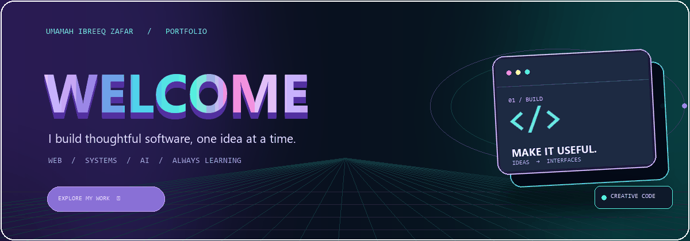

  
   
  <a href="https://ibreeqzafar.github.io/Umamah-Ibreeq-Portfolio/umamahibreeq.html"><strong>✦ Visit my portfolio ✦</strong></a>
  &nbsp; · &nbsp;
  <a href="mailto:ibreeq.zafar@gmail.com">Get in touch ↗</a>

 

  
  

## Hi, I’m Umamah 👋

I’m a Software Engineering undergraduate at **UBIT, University of Karachi** (class of 2028). I enjoy taking an idea from a rough sketch to a working, thoughtful experience—whether that means building a web app, solving a problem in C++, or exploring how AI can make a product more helpful.

I care about strong fundamentals, clear interfaces, and learning by building. I’m always glad to meet people working on meaningful software and to explore opportunities where I can contribute, collaborate, and grow.

## ✨ My portfolio

I made this site to share what I’m learning and building. It features a dimensional animated hero, a 3D technology globe, selected projects, and ways to connect.

**[Open my portfolio →](https://ibreeqzafar.github.io/Umamah-Ibreeq-Portfolio/umamahibreeq.html)**

## 🚀 Projects I’m proud of

| Project | What I built | Tools and concepts |
| --- | --- | --- |
| [ESSYRA ↗](https://github.com/ibreeqzafar/Essyra-Furniture-Store-Project) | An AI-powered furniture shopping experience with a product catalogue, order management, support and interior-design recommendation agents, and an interactive home tour. | HTML · CSS · JavaScript · Supabase · AI agents |
| [Red Vault ↗](https://github.com/ibreeqzafar/Red-Vault-Blood-Bank-System) | A C++ blood bank system for inventory, donor records, patient requests, and issuance history. | C++ · OOP · linked lists · queues · stacks · BSTs |
| [Sudoku Terminal Game ↗](https://github.com/ibreeqzafar/Sudoku-Terminal-Game) | I turned a Sudoku board validator into a playable terminal game with difficulty levels, unique-solution puzzles, hints, mistake checks, undo, and a timer. | C++ · arrays · validation logic · terminal UI |
| TCP Chatroom | A multi-client chat app using Java sockets, threading, and a server-client architecture. | Java · TCP sockets · concurrency · OOP |
| Partial Derivatives Calculator | A Python console tool that parses multivariable expressions and computes symbolic partial derivatives step by step. | Python · SymPy · mathematics |

I’m sharing my [GitHub profile](https://github.com/ibreeqzafar) for more of my code and ongoing work.

## 🧰 My toolkit

  
  
  
  
  
  
  
  
  

I’m growing my skills in **data structures, object-oriented programming, databases, operating systems, problem solving, Linux fundamentals, generative AI, and prompt engineering**. I’m also working through AI and Data Science learning with Saylani and Google’s AI Data Analytics course on Coursera.

## 🏅 A recent milestone

I received a **Top Performer Award** in the Generative & Agentic AI Application Developer program, Pak Angels Cohort 11 (2026).

## 📬 Let’s connect

I’d love to hear about thoughtful products, collaborative teams, and opportunities to build useful software.

  <a href="mailto:ibreeq.zafar@gmail.com">Email</a> &nbsp; · &nbsp;
  <a href="https://www.linkedin.com/in/umamah-ibreeq-9a2bb63a8/">LinkedIn</a> &nbsp; · &nbsp;
  <a href="https://github.com/ibreeqzafar">GitHub</a>

 

Made with curiosity, care, and a lot of iterations.

